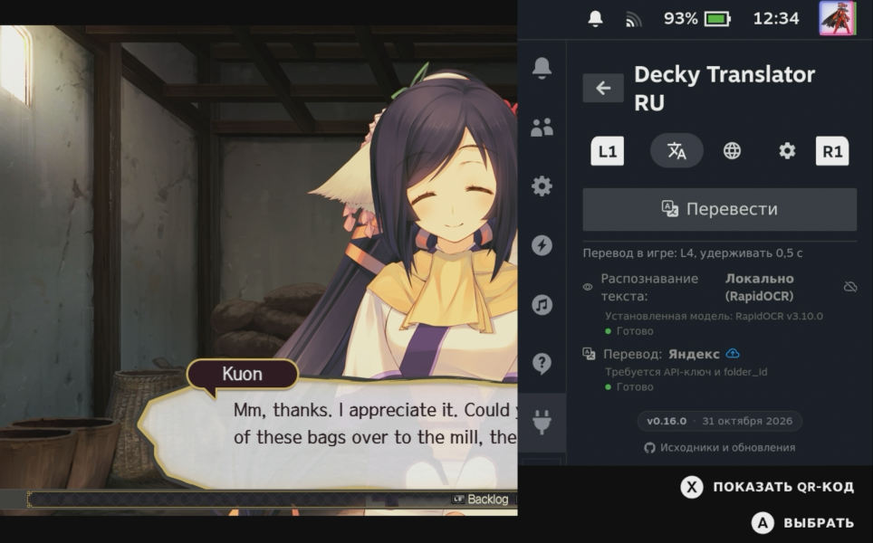
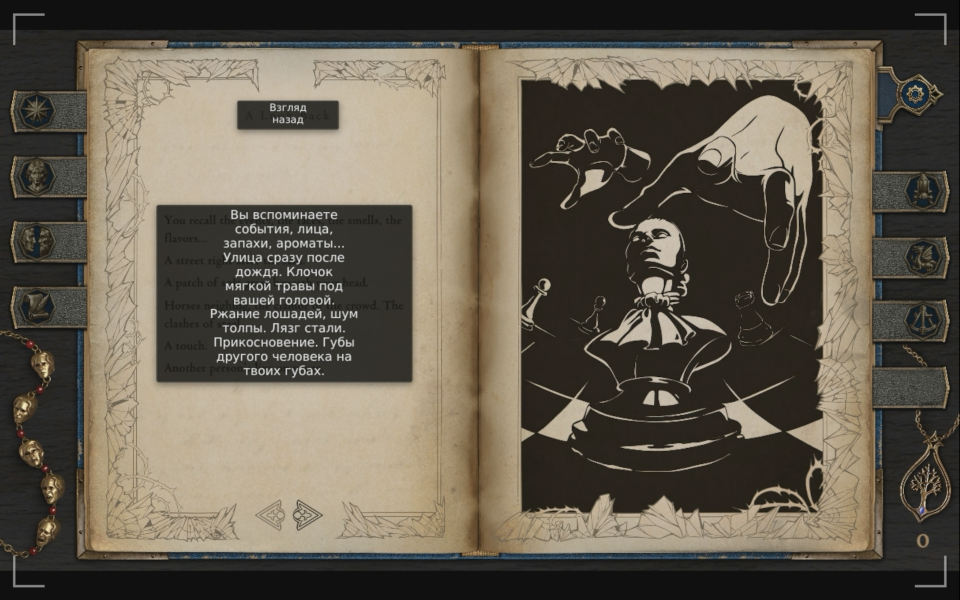

  

  
  
  

Плагин для **Decky Loader**, который позволяет переводить любой текст на экране вашего Steam Deck. Он делает снимок экрана, распознаёт текст с помощью OCR, переводит его и показывает результат через экранный оверлей. 

Идеально подходит для игр, которые не поддерживают русский язык, или для изучения иностранных языков.

Является форком проекта [Decky Translator](https://github.com/cat-in-a-box/Decky-Translator), его адаптированной и улучшенной версией. Кроме того, добавлены специфические для России методы перевода.

---

  

  

### Почему эта версия лучше для пользователей из России (и не только)?

Основные отличия и преимущества:

1. **Полная русификация интерфейса:** Все меню, настройки и уведомления переведены на русский язык для максимального удобства.
2. **Добавлены доступные провайдеры перевода:** Интегрирован **Yandex Translate** и **MyMemory**, что обеспечивает стабильную и быструю работу без необходимости настройки обхода для методов, которые могут быть недоступны из РФ.
3. **Улучшенный UX/UI для SteamOS:** 
   - Исправлен ряд проблем, которые были в оригинальном плагине.
   - Сам UI переработан.
4. **Прозрачность и приватность (Data Flow Badges):** В настройках добавлены наглядные индикаторы, показывающие, куда уходят ваши данные: данные обрабатываются локально на устройстве, в сеть отправляется только текст или весь скриншот.
5. **Оптимизация офлайн-моделей:** Улучшено качество локального распознавания и перевода (RapidOCR, NLLB-200), добавлена лёгкая офлайн-модель перевода Opus-MT (en→ru) на ~82 МБ.
6. **Улучшена работа локальных моделей:** при локальном OCR текст точнее разбивается на группы, а перед локальным переводом — аккуратнее нарезается на фразы. В итоге перевод получается качественнее.

---

### Требования

- Steam Deck (LCD или OLED) или другое портативное устройство на базе Linux (экспериментально).
- Установленный [Decky Loader](https://github.com/SteamDeckHomebrew/decky-loader).
- Подключение к интернету (требуется только для веб-провайдеров и первоначальной загрузки офлайн-моделей).

---

### Установка

#### Через магазин Decky
Пока плагина нет в магазине Decky. Если он туда попадёт, здесь появится инструкция.

#### Ручная установка
1. [Скачайте](https://github.com/konst2/Decky-Translator-RU/releases/latest/download/DeckyTranslatorRu.zip) последний релиз со страницы [Releases](https://github.com/konst2/Decky-Translator-RU/releases).
2. Загрузите архив `DeckyTranslatorRu.zip` в любую папку на вашем Steam Deck.
3. Откройте меню Decky, перейдите в **Настройки** <picture><source media="(prefers-color-scheme: dark)" srcset="assets/icons/light/gear.svg"></picture> → вкладка **General** → включите **"Developer Mode"**.
4. Перейдите на вкладку **Developer** → **Install Plugin from ZIP file** → выберите скачанный архив.

---

### Как пользоваться?

- **Обычный режим:** Откройте плагин, перейдите на главную вкладку и нажмите кнопку "Перевести". Чтобы закрыть оверлей, снова откройте меню Decky и нажмите "Закрыть оверлей".
- **Быстрый режим:** Зажмите кнопку **L4** (определена по умолчанию) для мгновенного перевода. Повторное удержание L4 отключит оверлей. Кнопки и комбинации можно изменить на вкладке "Управление".

---

### Как это работает?

Плагин позволяет комбинировать различные методы распознавания текста (OCR) и перевода.

Колонка «Работа в России»: ✅ — работает без дополнительных настроек, ⚠️ — может быть недоступен без обхода блокировок.

#### Распознавание текста (OCR)
| Провайдер | Работа в России | Тип | Описание | Требования |
|---|---|---|---|---|
| **Chrome Screen AI** ★ | ✅ | На устройстве | Использует библиотеку screen-ai из Chromium. Лучшее качество распознавания «из коробки». Рекомендуемый вариант. | Однократная загрузка ~120 МБ |
| **RapidOCR** | ✅ | На устройстве | Альтернативное офлайн-решение на базе моделей PP-OCRv5 (ONNX). Модель настроена на латиницу: лучший выбор для игр на английском, с другими языками справляется хуже. | Однократная загрузка ~75 МБ |
| **Gemini Vision** | ⚠️ | Веб | Распознавание и перевод за один вызов API. Идеально для стилизованного текста в играх. Можно выбрать модель: 2.5 Flash, 2.5 Flash Lite, 3 Flash, 3.1 Flash Lite. | Интернет + API-ключ |
| **Google Cloud Vision** | ⚠️ | Веб | Высокая точность и скорость. Отлично подходит для сложного текста. | Интернет + API-ключ |
| **OCR.space** | ⚠️ | Веб | Бесплатный облачный API. Хороший выбор для редких переводов. | Интернет |

#### Перевод
| Провайдер | Работа в России | Тип | Описание | Требования |
|---|---|---|---|---|
| **NLLB-200** | ✅ | На устройстве | Дистиллированная модель Meta (1.3B) через CTranslate2. Переводит между любыми поддерживаемыми языками. Полностью офлайн после загрузки. | Однократная загрузка ~1,4 ГБ |
| **Opus-MT (en→ru)** | ✅ | На устройстве | Лёгкая модель Helsinki-NLP через CTranslate2. Переводит только с английского на русский, зато весит в 17 раз меньше NLLB-200. | Однократная загрузка ~82 МБ |
| **Yandex Translate** | ✅ Но платный | Веб | Быстрый и качественный перевод, оптимизированный для русского языка. Большой бесплатный лимит. | Интернет + API-ключ и folder_id |
| **MyMemory** | ✅ | Веб | Бесплатный агрегатор переводов, регистрация не нужна. Лимит — 5 000 символов в день; если указать email в настройках, лимит вырастет до 50 000. | Интернет |
| **Google Translate** | ⚠️ | Веб | Классический веб-переводчик. | Интернет |
| **Google Cloud Translation** | ⚠️ | Веб | Профессиональное качество перевода. Имеет щедрый бесплатный лимит. | Интернет + API-ключ |
| **Gemini Vision** | ⚠️ | Веб | Если Gemini Vision выбран для распознавания, он сразу возвращает и перевод — отдельный переводчик не нужен, его выбор блокируется. | Интернет + API-ключ |

<h3> Как получить API-ключ Yandex?</h3>

Плагину нужны два значения: **API-ключ** сервисного аккаунта и **folder_id** — идентификатор каталога в Яндекс Облаке.

1. Войдите в [консоль Яндекс Облака](https://console.yandex.cloud/). Если платёжного аккаунта ещё нет, создайте его: без него сервис перевода не работает.
2. Откройте каталог (по умолчанию он называется `default`) и скопируйте его **идентификатор** — это и есть `folder_id`.
3. В этом каталоге перейдите в **Сервисные аккаунты** (Для этого легче всего нажать большую кнопку `Identity and Access Management`) → **Создать сервисный аккаунт**. Дайте ему роль `ai.translate.user`.
4. Откройте созданный аккаунт → **Создать новый ключ** → **Создать API-ключ**. Скопируйте секретную часть ключа: после закрытия окна её больше не покажут.
5. В плагине на вкладке **Перевод** выберите метод перевода «Яндекс», нажмите кнопку с ключом и введите `API-ключ` и `folder_id`.

<h3> Как получить API-ключ Gemini?</h3>

Ключ Gemini отдельный от ключа Google Cloud: он выдаётся в Google AI Studio, а не в Cloud Console.

1. Перейдите в [Google AI Studio](https://aistudio.google.com/app/apikey).
2. Войдите в аккаунт Google и нажмите "Create API key".
3. Скопируйте ключ и вставьте его в настройках плагина, выбрав Gemini Vision в качестве провайдера OCR.

<h3> Как получить API-ключ Google Cloud?</h3>

Один ключ подходит и для Google Cloud Vision, и для Google Cloud Translation.

1. В [Google Cloud Console](https://console.cloud.google.com/) создайте проект: **Select a project** → **New Project**, имя любое.
2. В [APIs & Services → Library](https://console.cloud.google.com/apis/library) найдите и включите **Cloud Vision API** и **Cloud Translation API**.
3. В [APIs & Services → Credentials](https://console.cloud.google.com/apis/credentials) нажмите **Create Credentials** → **API Key** и скопируйте ключ.

   

4. *(Необязательно, но лучше сделать.)* Откройте ключ, в **API restrictions** выберите **Restrict key** и оставьте только Cloud Vision API и Cloud Translation API. Тогда украденный ключ нельзя будет использовать для других сервисов.

   

5. В плагине на вкладке **Перевод** выберите Google Cloud для распознавания и/или перевода, нажмите кнопку с ключом и вставьте ключ.

**Никому не передавайте этот ключ.**

**Про оплату.** Бесплатного лимита (Vision — 1 000 запросов в месяц, Translation — 500 000 символов в месяц) обычно хватает для личного использования. Чтобы не получить неожиданный счёт, настройте лимит бюджета и уведомление в [Billing → Budgets & Alerts](https://console.cloud.google.com/billing/budgets).

---

### Устранение неполадок

- **Чёрный экран при захвате:** Попробуйте вызвать перевод ещё раз. Если проблема сохраняется, перезагрузите Steam Deck.
- **Переведенный текст слишком мелкий:** Увеличьте параметр "Масштаб шрифта" в настройках плагина.
- **Ошибка "Неверный API-ключ":** Проверьте правильность ввода ключа (без лишних пробелов).
- **Плохое распознавание / Нет перевода:** Попробуйте другую комбинацию провайдеров OCR и Перевода. Если проблема не исчезла, создайте [New Issue](https://github.com/konst2/Decky-Translator-RU/issues/new) и приложите файл `.log`.

---

### Сторонние зависимости

Тяжёлые модели не включены в архив плагина, а загружаются по требованию пользователя.

- **Chrome Screen AI:** [chromium/third_party/screen-ai](https://source.chromium.org/chromium/chromium/src/+/main:services/screen_ai/) (BSD-3-Clause)
- **RapidOCR (PP-OCRv5):** Модели экспортированы в ONNX. [RapidOCR](https://github.com/RapidAI/RapidOCR), [PaddleOCR](https://github.com/PaddlePaddle/PaddleOCR) (Apache 2.0)
- **NLLB-200:** [JustFrederik/nllb-200-distilled-1.3B-ct2-int8](https://huggingface.co/JustFrederik/nllb-200-distilled-1.3B-ct2-int8) (CC-BY-NC 4.0, Meta — только некоммерческое использование)
- **Opus-MT en→ru:** конвертация в CTranslate2 [manancode/opus-mt-en-ru-ctranslate2-android](https://huggingface.co/manancode/opus-mt-en-ru-ctranslate2-android) исходной модели [Helsinki-NLP/opus-mt-en-ru](https://huggingface.co/Helsinki-NLP/opus-mt-en-ru) (CC BY 4.0). Версия закреплена, каждый файл проверяется по SHA-256.
- **Python-пакеты (PyPI):** Pillow (MIT-CMU), requests (Apache 2.0), urllib3 (MIT), rapidocr (Apache 2.0), onnxruntime (MIT), ctranslate2 (MIT), sentencepiece (Apache 2.0), protobuf (BSD-3-Clause), py3langid. Подробнее о лицензиях — в [THIRD_PARTY_LICENSES](THIRD_PARTY_LICENSES).
- **Python Runtime:** Портативный Python 3.13 из [astral-sh/python-build-standalone](https://github.com/astral-sh/python-build-standalone) (PSF-2.0)
- **Веб-шрифты:** Загружаются с CDN (Google Fonts, OpenDyslexic) по лицензии SIL Open Font License (OFL).

---

### Поддержка и благодарности

Этот плагин является форком и развитием отличной работы оригинального автора. Если вам нравится этот проект, пожалуйста, поддержите оригинального разработчика:

**Особая благодарность:**
- **[cat-in-a-box](https://github.com/cat-in-a-box)** — создателю оригинального плагина *Decky Translator*, который послужил основой для этой версии.
